# Catálogo de estilos arquiteturais

Diagramas conceituais para o mesmo domínio didático de pedidos. Setas representam comunicação, exceto no último diagrama, que explicita dependências de código. Não são sistemas implantados ou resultados de benchmark.

## Cliente-servidor

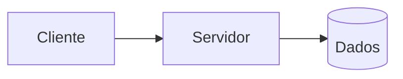

**Uso:** cliente solicita funções a um servidor. **Vantagem:** modelo simples. **Risco:** concentrar lógica sem responsabilidades claras. **Antiuso:** expor credenciais e banco ao cliente onde seria necessária uma API. **Java/Quarkus:** uma API pode ser o servidor; cliente-servidor não define sozinho suas camadas internas.

## Três tiers

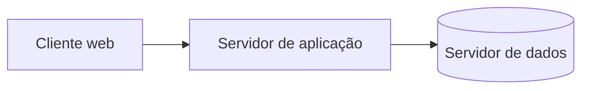

**Uso:** separar recursos de apresentação, aplicação e dados. **Vantagem:** responsabilidades e operação por tier. **Risco:** rede e infraestrutura adicionais. **Antiuso:** exigir três processos só porque existem três camadas lógicas. **Java:** um backend Quarkus pode executar no tier de aplicação.

## Monolito modular

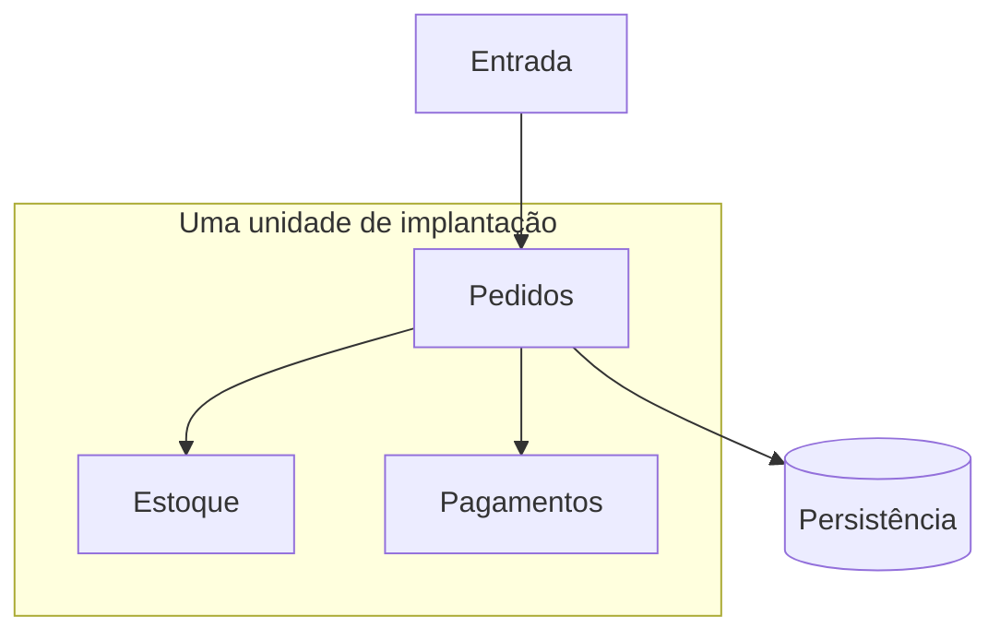

**Uso:** fronteiras de negócio claras com operação simples. **Vantagem:** chamadas locais e entrega única. **Risco:** dependências internas sem controle. **Antiuso:** afirmar que uma implantação impede modularidade. **Java:** pacotes por domínio e contratos entre módulos; o JPMS é uma opção, não um requisito.

## Camadas

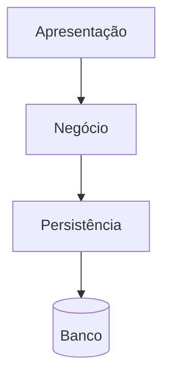

**Uso:** responsabilidades técnicas conhecidas. **Vantagem:** familiaridade. **Risco:** sinkhole, quando camadas apenas repassam. **Antiuso:** criar serviços vazios para cada tabela. **Quarkus:** resource, serviço de negócio e adaptador de dados; o framework não garante as fronteiras.

## Pipeline

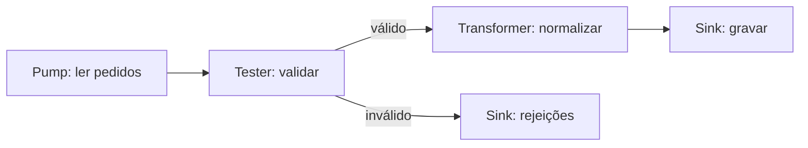

**Uso:** importação e transformação de dados. **Vantagem:** etapas testáveis e reutilizáveis. **Risco:** gargalo em uma etapa. **Antiuso:** forçar toda interação de negócio em um fluxo linear. **Java:** composição de funções ou Streams para uma sequência local; Apache Camel é outra opção conforme o caso.

## Microkernel

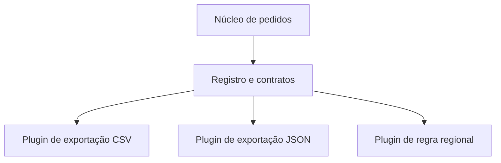

**Uso:** produto com extensões e customizações. **Vantagem:** núcleo estável. **Risco:** incompatibilidade entre core e plugins. **Antiuso:** criar mecanismo dinâmico onde nenhuma extensão é necessária. **Java:** interface e registro de implementações; `ServiceLoader` pode auxiliar descoberta. Ter módulos não torna o kernel Linux um microkernel de sistema operacional.

## Service-based

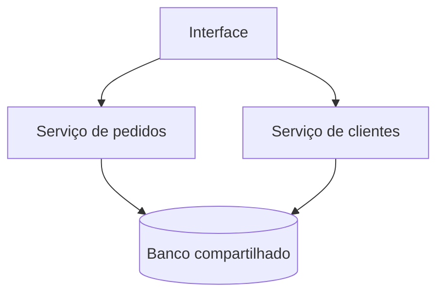

**Uso:** separar serviços abrangentes de domínio mantendo dados compartilhados. **Vantagem:** distribuição gradual. **Risco:** coordenação de schema e gargalo no banco. **Antiuso:** exigir autonomia total de dados com acesso irrestrito às mesmas tabelas. **Java/Quarkus:** aplicações separadas podem usar a mesma infraestrutura, com propriedade dos dados explicitada.

## Event-driven: broker

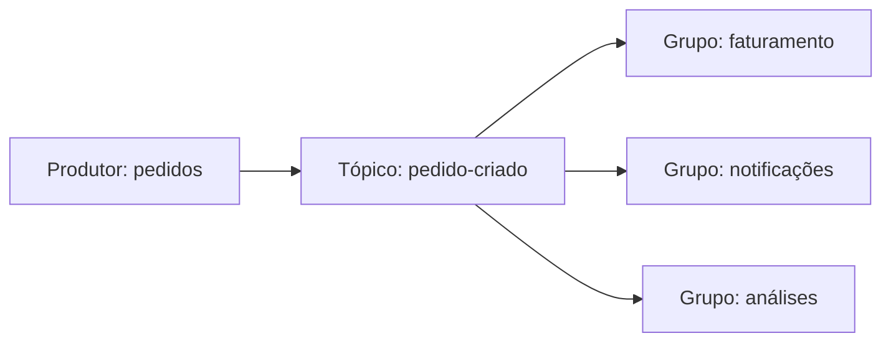

**Uso:** consumidores reagem a um fato. **Vantagem:** adicionar reações sem conhecer todos os destinos. **Risco:** contratos, duplicação e rastreabilidade. **Antiuso:** confundir confirmação de publicação com conclusão de todos os consumidores. **Kafka:** grupos diferentes recebem suas próprias leituras; consumidores no mesmo grupo dividem partições. Não significa broadcast para toda instância.

## Event-driven: mediator

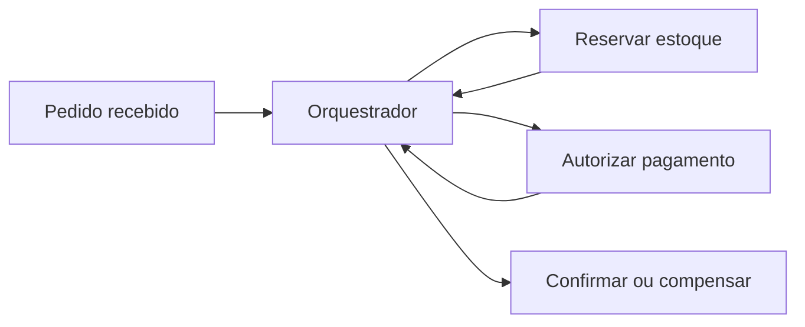

**Uso:** processo com etapas, prazo e compensações. **Vantagem:** coordenação explícita. **Risco:** complexidade no orquestrador. **Antiuso:** tratar a Saga como rollback técnico infalível. **Quarkus/Kafka:** comandos e resultados podem ser mensagens, com identidade, correlação e tratamento de reentrega.

## Space-based

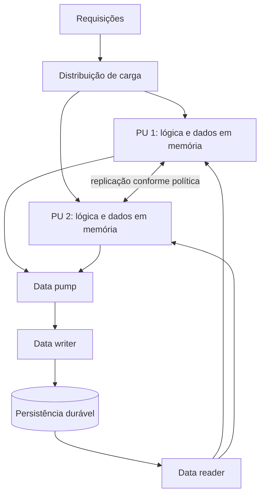

**Uso:** picos e gargalo de dados justificam distribuição em memória. **Vantagem:** retirar certas leituras/escritas do caminho crítico do banco. **Risco:** durabilidade e consistência. **Antiuso:** usar cache local e chamá-lo de cluster Space-Based completo. **Java:** um data grid distribuído exige desenho de replicação e recuperação; não há cluster implementado neste exercício.

## Microsserviços

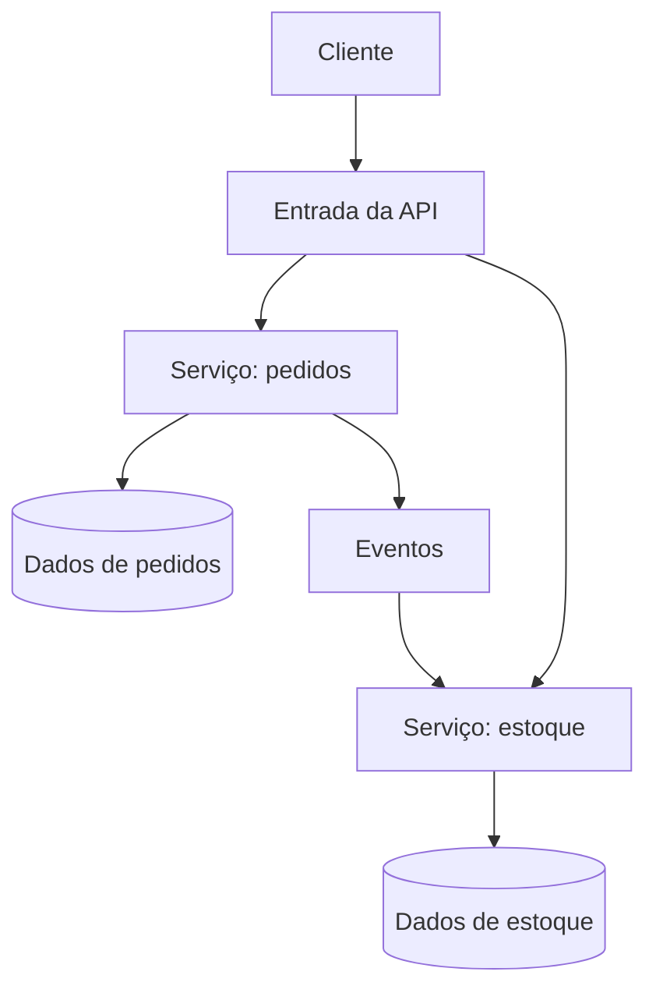

**Uso:** capacidades precisam de entrega e operação independentes. **Vantagem:** autonomia por domínio. **Risco:** rede, segurança, observabilidade e consistência. **Antiuso:** dividir CRUD por tabela e manter deploy coordenado de todos. **Quarkus/Kafka:** Quarkus implementa serviços; Kafka pode integrar fatos. Ferramentas não definem as fronteiras.

## Clean Architecture

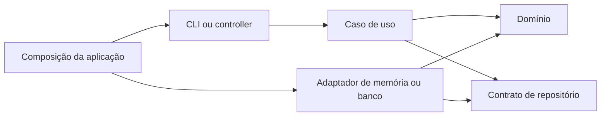

**Setas deste diagrama são dependências de código**, não a ordem de execução. O caso de uso chama a porta; a implementação é fornecida na composição.

**Uso:** regras importantes precisam de isolamento de detalhes. **Vantagem:** teste de políticas sem banco ou HTTP. **Risco:** abstrações excessivas. **Antiuso:** importar ORM no domínio enquanto se afirma independência. **Java:** o exercício da branch implementa domínio, porta, caso de uso e adaptador sem framework. Um resource Quarkus poderia ser outro adaptador de entrada.

Consulte a [comparação](comparacao.md), o [ADR](adr/0001-monolito-modular.md) e a [revisão](revisao.md).
